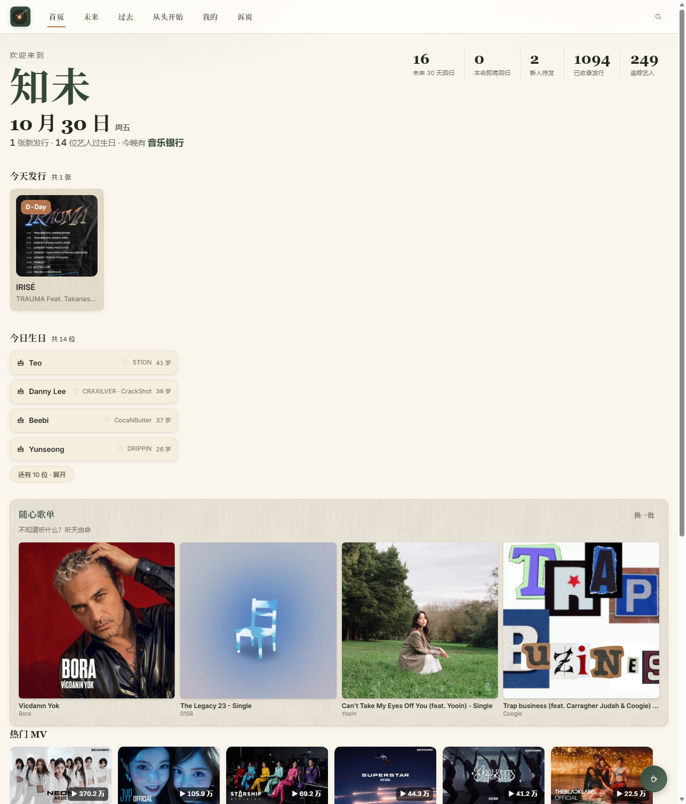

# 知未 · K-POP 回归日历

> **知道还没发生的事。** 把「未来谁会回归」和「过去发过什么」收进一个页面。
>
> 🌐 **在线使用：https://mywooji.cn**（打开即应用，免安装）



纯免费个人站：无广告、无会员、无联盟返利。只做信息聚合与外部跳转，不提供播放服务。

---

## 能干什么

| 功能 | 说明 |
|---|---|
| **回归日历** | 未来 7 天 / 本月 / 全部已发布，卡片带 D-N 倒计时 |
| **日历订阅** | `mywooji.cn/zhiwei.ics` —— 加进手机日历，回归日自动出现，每天同步 |
| **热门 MV** | 官方账号发布的正片，按播放量排序，取近一个月前 6 个 |
| **打歌节目** | 本周韩国音乐节目时间表 + 今晚谁上 |
| **今日生日** | 今天过生日的艺人，本命会高亮 |
| **随心歌单** | 不知道听什么？从已收录专辑里随机抽 4 张 |
| **备份迁移** | 「我的」里导出收藏与本命 JSON 文件，另一台手机或电脑可合并导入 |
| **收藏 / 本命** | 收藏针对单张专辑；本命针对艺人，其作品自动置顶 |
| **完整筛选** | 按发行类型（单曲 / EP / 正规专）、公司、艺人分类、任意日期区间；搜索支持中英文、团名、粉丝名 |
| **详情页** | 大封面、曲目列表、公司 / 粉丝名 / 出道年，并标注数据来源 |

页面：**首页 · 未来 · 过去 · 从头开始 · 我的 · 诉说**。

「诉说」是一个可以说话的窗口：报错、纠错、建议，或者只是想找个人说说，都会进站长邮箱。

---

## 数据

| 项目 | 数量 |
|---|---|
| 发行（专辑 / 单曲 / EP） | **5,272** 张（2016 – 2026） |
| 艺人 | **249** 位 |
| 曲目 | **14,403** 首 |
| 成员生日 | **6,635** 条 |
| 官方 MV | **146** 个 |
| 发行类型覆盖 | **96.6%**（5095 / 5272） |
| 有完整曲目的专辑 | **91.4%**（4817 / 5272） |

数据每天 09:38 自动抓取更新。**宁缺毋滥**：查不到就留空，不猜、不编造。

### 来源

| 来源 | 用途 |
|---|---|
| [kpopping.com](https://kpopping.com) | 未来回归日程、艺人性别分类名录 |
| [Apple Music](https://music.apple.com) | 历史发行归档 + 曲目，主力源 |
| [网易云音乐](https://music.163.com) | 补 Apple 没上架的专辑、发现新团体、提供发行类型三档标注 |
| [kpopcal.com](https://kpopcal.com) | 官方确认事件（CC BY 4.0） |
| 哔哩哔哩 | 官方账号发布的 MV 正片（按播放量排序，花絮 / 预告不算） |

---

## 本地开发

```bash
python scripts/build.py --export-only   # 只重新导出数据（不联网）
python tools/sync.py                    # core/ 分发到各端
python tools/smoke_test.py              # 功能自检（必须全绿）
python tools/layout_test.py             # 多视口布局自检
```

改代码前先读 [`AGENTS.md`](AGENTS.md)（给 AI 助手和新手的项目说明），
详细铁律在 [`WILLDO.md`](WILLDO.md)，过程记录在 [`更新日志与备忘.md`](更新日志与备忘.md)。

### 目录

```
core/        ★ 唯一源码（index.html / app.js / app.css）
scripts/     数据抓取与构建（build.py、sources.py、bilibili.py、fill_gaps.py…）
tools/       同步与自检（sync.py、smoke_test.py、fetch_covers.py…）
covers/      本地化的封面图（kpopping 那批有防盗链，已搬回来）
data/        数据产物：data.js + 年份切片 + zhiwei.ics + kpop.db
site/        ★ 网站：直接部署这个目录（Cloudflare / 服务器都用它）
desktop/     Windows（Electron）
mobile/      Android / iOS（Capacitor）
知未.html     离线单文件版（双击即用）
```

`desktop/app/`、`mobile/www/`、`site/`、`知未.html` 全部由 `tools/sync.py` 生成，**不要手改**。

---

## 部署

纯静态，两个地方各跑一份：

| 环境 | 方式 |
|---|---|
| 国内 | 阿里云轻量 + 宝塔（Nginx）。服务器每天 10:00 自动拉取最新站点 |
| 海外 | Cloudflare Workers（`wrangler deploy`） |

每天更新链路：GitHub Actions 抓数据 → 生成 `site/` → 服务器定时拉取 → 网站更新，全程无需人工。

---

## 关于

**名字**：知未 —— 知晓未发生的事。

**图标**：唱片 + 化作彗星的唱臂。唱片同心环由外向内收紧（越内越清晰）= 时间由远及近；
彗核落在唱片正中的铜色标签上 = 回归日。唱针落下的那一刻，就是回归开始。

**设计**：纸感。色板只有纸米 `#FAF6EE`、墨绿 `#33473A`、赭石 `#B5764F` 三档，
卡片是手撕毛边的手抄纸，控制项全部文字化、无胶囊按钮。

**合规**：皖ICP备2026037456号 · 皖公网安备34011102004379号（均已在页脚展示）。
